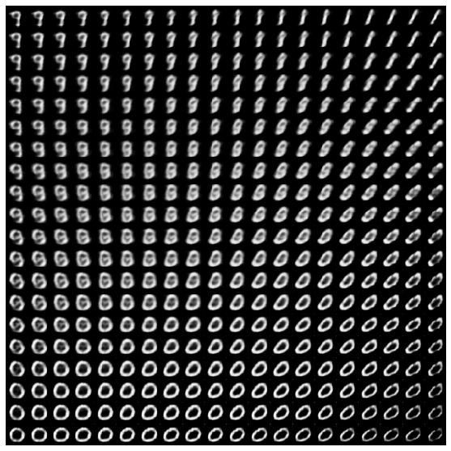

# AI Lectures for Developers

A five-day path from Python and numerical computing to neural networks and generative models.

[Course outline](#course-outline) · [Environment check](Install%20Test.ipynb) · [Getting started](#getting-started)

<p align="center">
  
</p>

*From code to generated images: the latent-space visualization saved in the [Day 5 VAE notebook](day5/src/tf6.%20generation%20by%20VAE%20-%20MNIST.ipynb).*

## Course outline

| Day | Focus | Exercises |
| --- | --- | --- |
| [1 · Python](day1/src/) | Programming fundamentals | Types, conditions, loops, files, functions, classes, and quizzes |
| [2 · Data](day2/src/) | NumPy and pandas | Arrays and tabular data |
| [3 · Practice](day3/src/) | Numerical and data analysis skills | Advanced NumPy, pandas, and exercises |
| [4 · Neural networks](day4/src/) | Classification and regression | Fashion-MNIST, Auto MPG, softmax, cross-entropy, and implementations from scratch |
| [5 · Deep learning](day5/src/) | CNNs, RNNs, and generative models | Image classification, text generation, VAEs, and GANs |

## Getting started

```bash
git clone https://github.com/scpark20/AI-lectures.git
cd AI-lectures
```

Open [Install Test.ipynb](Install%20Test.ipynb) in Jupyter to check NumPy, pandas, TensorFlow, and a convolution operation. Then follow the course folders in order, or start with a topic you already have the prerequisites for.

The notebooks contain their own imports and, where needed, package-installation cells. This is an archived course collection without a pinned environment; dependencies and dataset downloads should be checked for the lesson you plan to run.

## Sources

Several lessons adapt TensorFlow tutorials. Their original author credits, source links, and license notices are preserved in the notebooks. The VAE preview is an existing output from the lesson based on the TensorFlow convolutional VAE tutorial.
